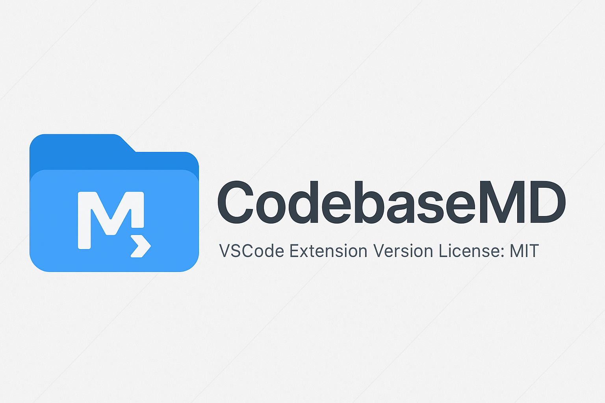

<p align="center">
  
</p>

<p align="center">
  <b>CodebaseMD</b> is a VS Code extension that exports a workspace, a selection or your Git changes as one Markdown, XML or plain-text document, ready to paste into an AI assistant or a review.
</p>

<p align="center">
  <a href="https://github.com/alpha912/codebase-md/releases/latest">Download</a> ·
  <a href="docs/README.md">Documentation</a> ·
  <a href="CHANGELOG.md">Changelog</a> ·
  <a href="CONTRIBUTING.md">Contributing</a> ·
  <a href="SECURITY.md">Security</a> ·
  <a href="SUPPORT.md">Support</a>
</p>

<p align="center">
  <a href="https://github.com/alpha912/codebase-md/releases/latest"></a>
  <a href="https://github.com/alpha912/codebase-md/actions/workflows/ci.yml"></a>
  <a href="https://marketplace.visualstudio.com/items?itemName=alpha912.codebase-md"></a>
  <a href="LICENSE.md"></a>
  <a href="https://reuse.software/"></a>
</p>

> **Status:** 3.0.0 is the current release. `main` has unreleased changes: the
> next release requires VS Code 1.146 or later (3.0.0 runs on 1.70 and later).
> See the [changelog](CHANGELOG.md) and the [limitations](#limitations).

## Contents

- [What CodebaseMD is](#what-codebasemd-is)
- [A short example](#a-short-example)
- [Install](#install)
- [Commands](#commands)
- [Settings](#settings)
- [Choosing what is shared](#choosing-what-is-shared)
- [How it works](#how-it-works)
- [Limitations](#limitations)
- [Repository layout](#repository-layout)
- [Development](#development)
- [Documentation](#documentation)
- [Contributing](#contributing)
- [License](#license)

## What CodebaseMD is

Giving an assistant or a reviewer the right code usually means copying files
one at a time. CodebaseMD does it in one step: pick a scope, and it writes a
single document with a folder tree, per-language statistics, a token estimate
and the contents of each file.

- **Scopes:** the workspace, selected files and folders, changes against
  `HEAD`, or the current file (including unsaved edits).
- **Formats:** Markdown with a linked contents list, escaped XML, or plain
  text.
- **Destinations:** a file, the clipboard, or a new editor tab.
- **Content modes:** full source, a compact Micro summary, or a declaration
  skeleton, for fitting more files into a context budget.
- **Guard rails:** recognizable secrets are redacted by default, ignore rules
  are respected, symbolic links are not followed, and a warning appears before
  an export exceeds your token budget.

CodebaseMD runs entirely on your machine. It does not upload source code, call
an AI provider or collect telemetry.

## A short example

<table>
<tr>
<td width="42%" valign="top">

A workspace with three files:

```text
├── .env
├── README.md
└── src/
    └── greet.ts
```

`.env` holds a token:

```dotenv
API_TOKEN="sk_live_abc…"
```

Run **CodebaseMD: Export Wizard**, choose
*Workspace → Full → Markdown → Clipboard*,
and paste.

The token is replaced before the export
leaves the editor, and the summary line
reports one redaction.

</td>
<td width="58%" valign="top">

````markdown
# Project Export

3 files | 28 estimated content tokens (characters / 4) | 1 redactions | full mode

## Languages

| Language | Files | Estimated tokens |
| --- | ---: | ---: |
| dotenv | 1 | 7 |
| markdown | 1 | 2 |
| typescript | 1 | 19 |

## Contents

- [\.env](#file-1) — dotenv, ~7 tokens
- [README\.md](#file-2) — markdown, ~2 tokens
- [src/greet\.ts](#file-3) — typescript, ~19 tokens

### \.env

```dotenv
API_TOKEN="***REDACTED***"
```

### src/greet\.ts

```typescript
export function greet(name: string): string {
  return `Hello, ${name}`;
}
```
````

</td>
</tr>
</table>

The output above is abridged: a real export also lists the largest files and
the folder tree. XML and plain-text exports carry the same information.

## Install

1. Download the `.vsix` from
   [GitHub Releases](https://github.com/alpha912/codebase-md/releases/latest).
   A SHA-256 checksum is published next to it.
2. In VS Code, open **Extensions → … → Install from VSIX…** and select the
   file.
3. Open a local folder and run **CodebaseMD: Export Wizard** from the Command
   Palette.

The extension is also on the
[Visual Studio Marketplace](https://marketplace.visualstudio.com/items?itemName=alpha912.codebase-md).
Marketplace publication is a separate step and can lag behind GitHub Releases.
Git is needed only for Git exports. See [installation](docs/installation.md)
for details.

## Commands

| Command Palette title | What it does |
| --- | --- |
| **CodebaseMD: Export Wizard** | Four steps: scope, content mode, format, destination |
| **CodebaseMD: Export Git Changes** | Files changed against `HEAD` plus untracked files, using your settings |
| **CodebaseMD: Copy Current File** | Copies the active saved file, including unsaved edits |
| **Export Codebase as Markdown** | Whole workspace folder to a Markdown file |
| **Export Selected as Markdown** | Selected files and folders to a Markdown file |
| **Export Micro Codebase** | Whole workspace folder as a Micro summary |
| **Export Selected as Micro Codebase** | Selected files and folders as a Micro summary |

The two selected-export commands also appear in the Explorer context menu.
Multi-root workspaces prompt for one folder per export. [Usage](docs/usage.md)
walks through each command.

## Settings

Search for **CodebaseMD** in Settings. Every key has the `codebaseMD.` prefix
and can be set per workspace folder.

| Setting | Default | Meaning |
| --- | --- | --- |
| `format` | `markdown` | `markdown`, `xml` or `text` |
| `contentMode` | `full` | `full`, `micro` or `skeleton` |
| `target` | `file` | `file`, `clipboard` or `editor` |
| `tokenBudget` | `32000` | Warn above this estimate; `0` disables the warning |
| `redactSecrets` | `true` | Replace recognizable secrets before exporting |
| `maxFileSizeKB` | `1024` | Largest file content or diff to include, in KiB |
| `exclude` | `[]` | Extra gitignore-style patterns to leave out entirely |
| `respectGitignore` | `true` | Apply root and nested `.gitignore` files |
| `includeDiff` | `false` | Add tracked-file diffs to Git exports |
| `lineNumbers` | `false` | Number the lines of the exported representation |
| `customHeader` | empty | Text added to the top of each export, such as your task |

The wizard starts from these values. The four original commands always save
Markdown in their full or Micro mode, and Copy Current File always uses the
clipboard. [Configuration](docs/configuration.md) has examples.

## Choosing what is shared

| Rule | Effect |
| --- | --- |
| `.gitignore` (root and nested) and `codebaseMD.exclude` | Matching files are left out entirely, including their paths |
| `.codebaseignore` in the workspace root | Matching files keep their path in the tree; their content is omitted |
| Built-in exclusions | Dependency and build directories, lockfiles, archives and `codebase-export.*` are skipped |
| Size and binary checks | Oversized and binary files get an omission notice instead of content |
| Symbolic links and junctions | Never followed, even when selected explicitly |

The same rules apply to explicit selections and to Git exports.

## How it works

```text
VS Code command ──► config.ts ──► exporter.ts ──► formatters.ts ──► file / clipboard / editor
   (extension.ts)   validated      │
                    settings       ├─ fsUtils.ts   ignore rules, containment, directory walk
                                   ├─ git.ts       changed files and filtered diffs
                                   ├─ secrets.ts   redaction, before any transformation
                                   ├─ analyzer.ts  Micro summaries, language mapping
                                   ├─ skeleton.ts  declaration outlines
                                   └─ tokens.ts    characters / 4 estimate
```

Only `extension.ts` and `config.ts` touch VS Code APIs. The export pipeline is
plain Node code, which is why the unit tests can run it against temporary
directories and Git repositories without an editor. Nothing is written until
the export has been prepared and the budget check has passed.
[Architecture](docs/architecture.md) describes each stage and the safety
properties it keeps.

## Limitations

- **Token estimates** are `ceil(characters / 4)`, not a model tokenizer. Real
  usage can differ substantially.
- **Secret redaction** is heuristic. It recognizes common provider tokens,
  JWTs, private keys and password or token assignments; it can miss secrets
  and can redact ordinary values. Review exports before sharing them. Paths
  stay visible unless excluded.
- **Micro and skeleton modes** use regular expressions, not language parsers.
  They can miss multiline declarations or misread signatures. Use full mode
  when exact source matters.
- **Git exports** reflect the disk and index against `HEAD`. Unsaved buffers do
  not select a file, diffs do not include untracked files, and Git exports
  require a trusted workspace.
- **Workspaces** must be local folders, one folder per export. Virtual
  filesystems and untitled files are not supported.
- **Platforms:** CI covers Linux and Windows. macOS is expected to work but is
  not tested in CI.

## Repository layout

| Path | Contents |
| --- | --- |
| `src/` | Extension source; one module per pipeline stage |
| `src/test/unit/` | Unit tests for the pipeline and helpers (no VS Code needed) |
| `src/test/suite/` | Tests that run inside a VS Code extension host |
| `docs/` | User and developer documentation |
| `releases/` | Release notes per version, and VSIX files of releases before 3.0 |
| `scripts/` | Release publishing script used by CI |
| `assets/` | Icon, logo and banner |
| `.github/` | CI workflow, Dependabot, issue and pull request templates |
| `CodebaseMD-Web/` | Placeholder for a separate web prototype; not part of the extension |

## Development

You need [Bun](https://bun.sh) 1.4+, Node.js 22.12+ (24 recommended) and Git.

```sh
bun install --frozen-lockfile
bun run check              # Biome lint and format check, then unit tests
bun run test:integration   # extension-host tests (Linux: prefix with xvfb-run -a)
bun run package            # build the VSIX
```

CI runs the same steps on Linux and Windows, audits dependencies, checks REUSE
licensing metadata and keeps the built VSIX as an artifact. See
[CONTRIBUTING.md](CONTRIBUTING.md) for the workflow and
[AGENTS.md](AGENTS.md) for a short guide aimed at coding agents.

## Documentation

| Document | For |
| --- | --- |
| [Installation](docs/installation.md) | Installing and verifying the extension |
| [Usage](docs/usage.md) | Each command, step by step |
| [Configuration](docs/configuration.md) | Settings, ignore files and limits |
| [Micro export format](docs/micro-export-format.md) | The compact summary notation |
| [Troubleshooting](docs/troubleshooting.md) | Common problems and fixes |
| [Architecture](docs/architecture.md) | Pipeline stages and safety properties |
| [Developer reference](docs/api-reference.md) | Modules, command IDs and the `exportCodebase` contract |
| [Changelog](CHANGELOG.md) and [release notes](releases/) | What changed in each version |

## Contributing

Bug reports, fixes and documentation improvements are welcome. Start with
[CONTRIBUTING.md](CONTRIBUTING.md); use the
[issue templates](https://github.com/alpha912/codebase-md/issues/new/choose) for
bugs and ideas, and [SECURITY.md](SECURITY.md) for vulnerabilities. Everyone
taking part is expected to follow the [Code of Conduct](CODE_OF_CONDUCT.md).

## License

[MIT](LICENSE.md) © Alphin Tom. The repository follows the
[REUSE](https://reuse.software/) specification: source files carry SPDX
headers and [`REUSE.toml`](REUSE.toml) covers the rest. The Code of Conduct is
adapted from the Contributor Covenant under CC BY 4.0.
